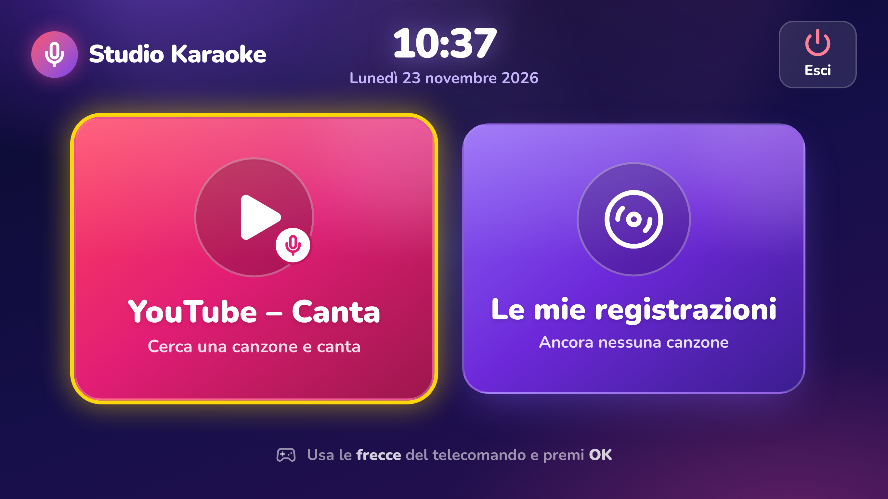
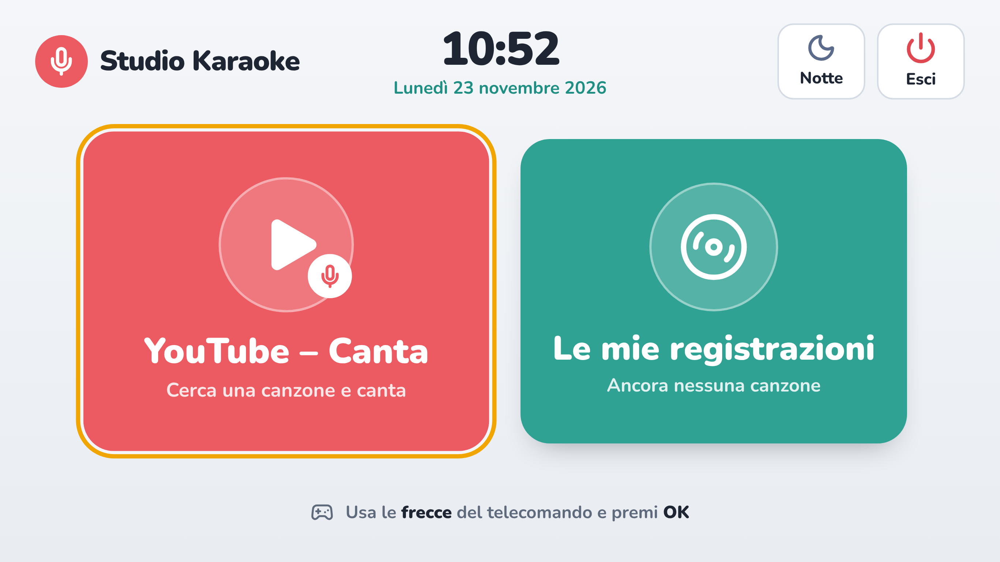
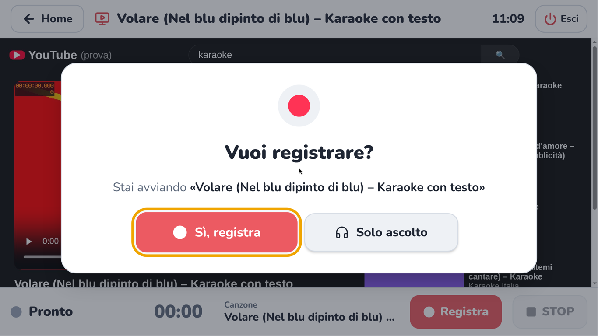
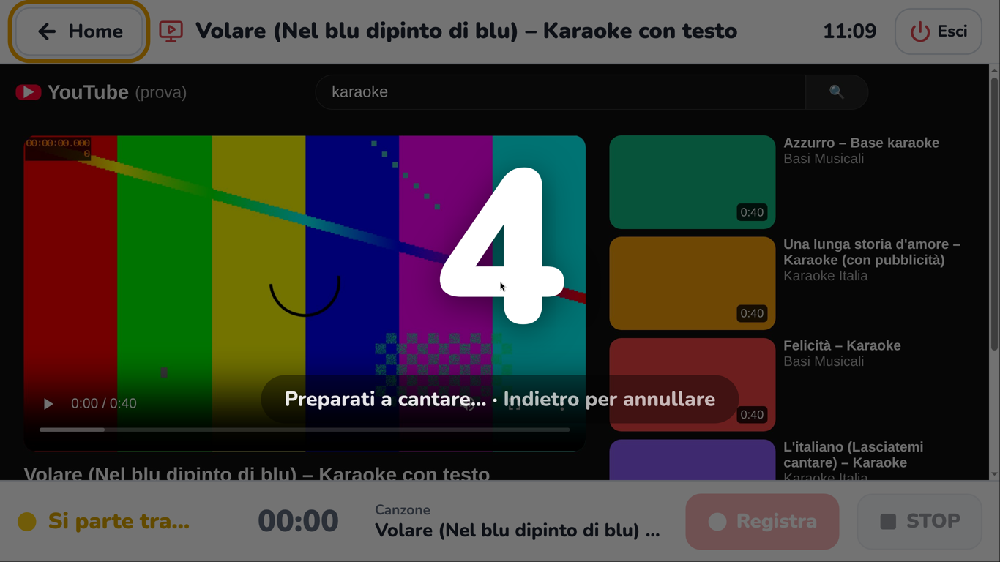

# 🎤 Studio Karaoke

App desktop per Windows 11 che permette di cantare sulle basi di YouTube e registrare voce + base direttamente dal mixer, usando **solo il telecomando**.

> Stato: **fase 2 completata**: YouTube dentro l'app, con il video che si ferma al play, il messaggio "Vuoi registrare?" e il conto alla rovescia. La registrazione vera arriva nella fase 3.

Tema **Ardesia**, con il pulsante in Home per passare da notte a giorno:

| Notte | Giorno |
|---|---|
|  |  |

Gli altri temi (palco, corallo, cielo, salvia, vinile) sono in `docs/screenshots/temi/` e si scelgono con l'impostazione `tema`.

## Comandi

Servono **Node.js 22** o più recente.

```bash
npm install
```

```bash
npm run dev            # avvia l'app a schermo intero (F12 = strumenti sviluppatore)
```

```bash
npm run dev:finestra   # avvia in una finestra 1366×768, comoda per lo sviluppo
```

```bash
npm run build          # controllo dei tipi + build di produzione in out/
```

```bash
npm run dist:win       # crea l'installer NSIS per Windows x64 in release/
```

### Provare senza internet: il "finto YouTube"

`dev/finto-youtube` è una pagina che imita il player di YouTube (stesso markup, pubblicità finta, navigazione da SPA). Serve ffmpeg per generare il video di prova.

```bash
npm run finto-youtube        # in un terminale
```

```bash
npm run dev:finto-youtube    # in un altro: l'app usa il finto YouTube
```

L'installer va creato su Windows (o con Wine). In sviluppo, per chiudere l'app usa **Esci → Chiudi l'app**, oppure Alt+F4.

## Struttura del progetto

```
electron/
  main.ts          finestra a schermo intero senza bordi, kiosk, istanza singola,
                   avvio automatico, riavvio dopo un crash, IPC, spegnimento del PC
  preload.ts       API sicura esposta all'interfaccia (window.studio)
  ipc-types.ts     contratto IPC tipizzato condiviso
  settings.ts      impostazioni persistenti (electron-store)
  youtube.ts       vista di YouTube (WebContentsView), zoom, tasti, foto per i dialog
  youtube-preload.ts  dentro YouTube: ferma il video al play, rileva pubblicità
src/
  App.tsx          gestione delle schermate
  screens/         Home, schermate in arrivo
  components/      Button, Dialog, Toast, Clock, ExitButton, AppLogo,
                   ScreenHeader, StatusBanner
  navigation/      navigazione spaziale con le frecce e tasti del telecomando
  hooks/           useAudioDevices (rilevamento del mixer USB)
  lib/api.ts       accesso all'API (con versione finta per l'anteprima nel browser)
  styles/          tema scuro, focus giallo, animazioni
docs/screenshots/  anteprime delle schermate
```

### Flusso YouTube

1. Si sceglie una canzone su YouTube (con l'air mouse) e parte il video.
2. L'app lo ferma subito, lo riporta all'inizio e chiede **"Vuoi registrare?"**.
3. **Sì, registra** → conto alla rovescia 5-4-3-2-1-VAI! → il video riparte da capo.
4. **Solo ascolto** → il video riparte e per quel video non chiede più (finché non lo si riapre).
5. Durante la pubblicità non chiede nulla: aspetta che inizi la canzone.
6. Indietro torna alla pagina precedente di YouTube; se non c'è, alla Home.

| Vuoi registrare? | Conto alla rovescia |
|---|---|
|  |  |

### Telecomando

| Tasto | Azione |
|---|---|
| Frecce | spostano il focus (bordo giallo) |
| OK / Invio | conferma |
| Indietro (Esc, BrowserBack, Backspace) | chiude il dialog o torna indietro |
| Home (BrowserHome) | torna alla Home |
| Air mouse | passando sopra un pulsante gli dà il focus |

Ogni dialog intrappola il focus e parte dalla scelta più sicura (es. "Annulla").

## Configurazione di Windows (una volta sola)

1. **Login automatico.** Premi Win+R e scrivi `netplwiz`. Togli la spunta da "Per utilizzare questo computer è necessario che l'utente immetta il nome e la password", poi conferma con la password. Se l'opzione non c'è: Impostazioni → Account → Opzioni di accesso → disattiva "Per una maggiore sicurezza, consenti l'accesso a Windows Hello…".
2. **Notifiche.** Impostazioni → Sistema → Notifiche: disattiva le notifiche e attiva "Non disturbare". Disattiva anche i suggerimenti in Impostazioni → Personalizzazione → Start.
3. **Audio sul mixer.** Impostazioni → Sistema → Audio:
   - in *Output* scegli **USB Audio CODEC** (il mixer Alto Live 802);
   - in *Input* scegli **USB Audio CODEC**;
   - nelle proprietà dell'ingresso imposta il formato **2 canali, 48000 Hz** e disattiva i "Miglioramenti audio".
4. **Avvio automatico.** Dopo l'installazione l'app si avvia da sola a ogni accensione: puoi disattivarlo dalle impostazioni (fase 7).
5. **Risparmio energetico.** Impostazioni → Sistema → Alimentazione: schermo e sospensione impostati su "Mai" mentre il PC è collegato alla corrente.

## Fasi di sviluppo

- [x] 1. Scheletro: Electron + React + TypeScript, schermo intero, Home, pulsante Esci, frecce, toast e dialog
- [x] 2. YouTube nel `WebContentsView` con zoom, barre e intercettazione del play
- [ ] 3. Registrazione: VU meter, conto alla rovescia, MediaRecorder, pubblicità
- [ ] 4. Salvataggio: tastiera a schermo, selettore cartelle, MP3, recupero dei file temporanei
- [ ] 5. Le mie registrazioni: cartelle, filtri, player
- [ ] 6. Registrazioni eliminate (14 giorni)
- [ ] 7. Impostazioni, tester dei tasti, avvio automatico
- [ ] 8. Ricerca vocale, copia su chiavetta USB
- [ ] 9. Installer e guida finale
